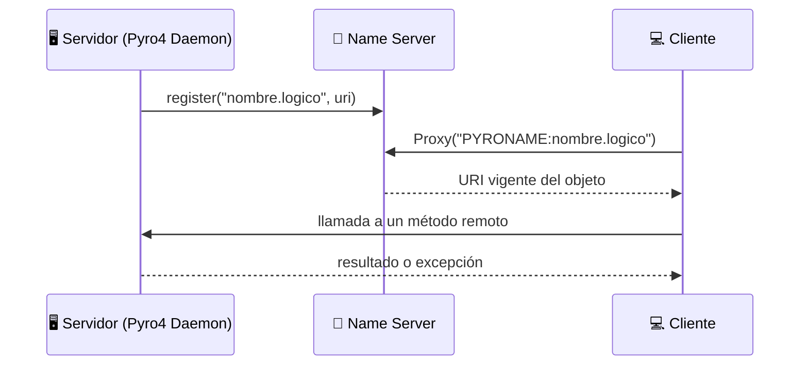

<div align="center">

# 🌐 Programación Distribuida con Pyro4 y RPC en Python

### Seis proyectos que recorren la invocación de métodos remotos: de una calculadora a una subasta en tiempo real y un login con doble factor por Telegram


</div>

---

## 📖 Descripción

Repositorio de la **Práctica de Laboratorio de RPC con Python** de la asignatura **Sistemas Distribuidos** (Universidad Politécnica Salesiana, Sede Sur, Quito). Cada carpeta es un proyecto independiente que introduce un concepto nuevo de la programación distribuida con **Pyro4** (*Python Remote Objects*): llamar a un método de otra máquina como si fuera una función local.

> 💡 **Idea central:** el cliente solo conoce un **nombre lógico** y un conjunto de métodos. Dónde vive el objeto, en qué puerto y cómo viajan los datos lo resuelve Pyro4.

---

## 👥 Equipo

| | Integrante | GitHub |
|---|---|---|
| 🧑‍💻 | **Josué Samuel Vele** | [@JosueVele77](https://github.com/JosueVele77) |
| 🧑‍💻 | **Christian Humberto Carrión** | [@Ghoul2001](https://github.com/Ghoul2001) |
| 🧑‍💻 | **Juan David Figueroa** | [@xErnyx](https://github.com/xErnyx) |

🎓 **Docente:** Ing. Ricardo Proaño

---

## 🗺️ Mapa de proyectos

| | Proyecto | Concepto que practica | Nombre en el Name Server |
|---|---|---|---|
| 🧮 | [`basic-remote-calculator`](basic-remote-calculator) | **Nivel 1.** Objeto remoto básico con operaciones aritméticas | `calculadora` |
| 📨 | [`nameserver-notification-system`](nameserver-notification-system) | **Nivel 2.** Localización de servicios por nombre lógico | `practica.mensajeria` |
| 🏦 | [`stateful-distributed-bank`](stateful-distributed-bank) | **Nivel 3.** Estado por cliente con `instance_mode="session"` y excepciones propias | `cuenta_bancaria` |
| ⚡ | [`concurrent-async-callbacks`](concurrent-async-callbacks) | **Nivel 4.** Llamadas asíncronas con `Pyro4.Future` y concurrencia | `practica.procesador` |
| 🔨 | [`distributed-auction-system`](distributed-auction-system) | **Caso de estudio.** Subasta en vivo con instancia compartida, `Lock` y consola interactiva | `subastas.central` |
| 🔐 | [`mfa-telegram-bot-pyro4`](mfa-telegram-bot-pyro4) | **Proyecto avanzado.** Autenticación en dos pasos con códigos enviados por Telegram | `autenticacion.mfa` |

> 📂 Cada carpeta incluye su propio `README.md` con la explicación detallada, los comandos y los errores posibles.

---

## 🏗️ Arquitectura general

Todos los proyectos siguen el mismo patrón: el servidor **registra** su objeto en el Name Server y el cliente lo **localiza por nombre** antes de invocar sus métodos.



### 🎛️ Políticas de instancia usadas

| Política | Instancias | Dónde se usa |
|---|---|---|
| `session` | Una por conexión de cliente | 🏦 Banco distribuido |
| Instancia única (se registra el objeto) | Una compartida por todos | 🔨 Subastas |
| Estado por usuario con `Lock` propio | Una instancia, estado separado por cuenta | 🔐 MFA con Telegram |

---

## 📁 Estructura del repositorio

```text
pyro4-rpc-distributed-programming/
├── 🧮 basic-remote-calculator/          # Nivel 1: main.py + cliente.py
├── 📨 nameserver-notification-system/   # Nivel 2: servidor.py + cliente.py
├── 🏦 stateful-distributed-bank/        # Nivel 3: servidor.py + cliente.py + excepciones.py
├── ⚡ concurrent-async-callbacks/       # Nivel 4: servidor.py + cliente.py
├── 🔨 distributed-auction-system/       # Subastas: servidor.py + cliente.py + consola.py
├── 🔐 mfa-telegram-bot-pyro4/           # MFA: servidor, cliente, autenticación, bot de Telegram
└── 🙈 .gitignore
```

---

## 🛠️ Preparación

> 🐍 Requiere **Python 3.10 o superior**.

Desde la raíz del repositorio, crea y activa un entorno virtual e instala las dependencias:

```powershell
python -m venv .venv
.\.venv\Scripts\Activate.ps1
pip install Pyro4==4.82 prompt_toolkit
```

En Linux o macOS, la activación es `source .venv/bin/activate`.

| Dependencia | La necesitan |
|---|---|
| `Pyro4==4.82` | Todos los proyectos |
| `prompt_toolkit` | 🔨 Subastas |
| Token de un bot de Telegram | 🔐 MFA (ver su README) |

---

## 🚀 Ejecución rápida

Cada proyecto necesita **tres terminales** abiertas en la raíz, con `.venv` activado. Respeta el orden.

### 1️⃣ Name Server (una sola vez)

```powershell
python -m Pyro4.naming
```

### 2️⃣ Servidor del proyecto elegido

| Proyecto | Servidor | Cliente |
|---|---|---|
| 🧮 Nivel 1 | `python basic-remote-calculator\main.py` | `python basic-remote-calculator\cliente.py` |
| 📨 Nivel 2 | `python nameserver-notification-system\servidor.py` | `python nameserver-notification-system\cliente.py` |
| 🏦 Nivel 3 | `python stateful-distributed-bank\servidor.py` | `python stateful-distributed-bank\cliente.py` |
| ⚡ Nivel 4 | `python concurrent-async-callbacks\servidor.py` | `python concurrent-async-callbacks\cliente.py` |
| 🔨 Subastas | `python distributed-auction-system\servidor.py` | `python distributed-auction-system\cliente.py` |
| 🔐 MFA | `python mfa-telegram-bot-pyro4\servidor.py` | `python mfa-telegram-bot-pyro4\cliente.py` |

### 3️⃣ Cliente

Ejecuta el cliente de la tabla en otra terminal. Para probar la concurrencia en los niveles 3, 4 y en las subastas, abre **varios clientes** a la vez.

> ⚠️ En 🔨 Subastas y 🔐 MFA, lee primero el `README.md` de la carpeta: el operador debe preparar la subasta y el servidor MFA pide el token del bot y el registro de usuarios.

---

## 🌍 Ejecución en otras computadoras

Las subastas y el MFA se probaron en varios equipos de una misma red local. Usa la IPv4 real del servidor (el ejemplo usa `172.17.44.154`).

**🖥️ En el servidor, primera terminal:**

```powershell
python -m Pyro4.naming -n 172.17.44.154 -p 9090
```

**🖥️ En el servidor, segunda terminal:**

```powershell
$env:PYRO_HOST = "172.17.44.154"
$env:PYRO_NS_HOST = "172.17.44.154"
python distributed-auction-system\servidor.py
```

**💻 En cada cliente:**

```powershell
$env:PYRO_NS_HOST = "172.17.44.154"
python distributed-auction-system\cliente.py
```

Los demás niveles están pensados para ejecución local.

---

## 🧠 Conceptos clave del laboratorio

| Concepto | Qué demuestra | Proyecto |
|---|---|---|
| `@Pyro4.expose` | Qué métodos pueden invocarse por red; los que empiezan con `_` no se exponen | Todos, y 🔨 Subastas |
| Name Server y `PYRONAME` | Localización por nombre en lugar de URI fija | 📨 Nivel 2 en adelante |
| `instance_mode="session"` | Cada cliente conserva su propio saldo | 🏦 Banco |
| Excepciones personalizadas | Errores con tipo propio que cruzan la red | 🏦 Banco y 🔐 MFA |
| `Pyro4.Future` | El cliente sigue trabajando mientras el servidor procesa | ⚡ Nivel 4 |
| `threading.Lock` | Ofertas simultáneas sin condiciones de carrera | 🔨 Subastas |
| Versionado del estado | Una consulta antigua no sobrescribe una oferta nueva | 🔨 Subastas |
| `Pyro4.current_context.client` | El código MFA solo se valida desde la conexión que verificó la contraseña | 🔐 MFA |
| PBKDF2, `secrets` y bloqueo temporal | Contraseñas con hash, códigos aleatorios y defensa contra fuerza bruta | 🔐 MFA |

---

## 🔒 Seguridad

> 🚨 **Importante:** Pyro4 no cifra el tráfico por defecto y el Name Server arranca con la advertencia *"HMAC key not set"*. Usa estos proyectos solo en un entorno local o en una red controlada. Para redes no confiables se necesita configurar TLS en Pyro4.

- 🙈 El token del bot de Telegram **nunca** se sube a Git: se lee de `TELEGRAM_BOT_TOKEN` o del archivo local `.telegram_token`, que está en `.gitignore`.
- 🔑 Si un token se expone por accidente, revócalo con `/revoke` en [@BotFather](https://t.me/BotFather).
- 🧠 Todo el estado (cuentas, saldos, subastas, códigos) vive en memoria y se pierde al cerrar el servidor.

---

## 📄 Documentación del laboratorio

| Documento | Contenido |
|---|---|
| 📘 **Taller Grupal Práctica de Laboratorio RPC con Python** | Informe IEEE: fundamentación teórica y Niveles 1 al 4 |
| 📗 **Práctica de Laboratorio Subastas y Proyecto Bot Telegram** | Informe IEEE: subasta distribuida y autenticación MFA con Telegram |

---

## 🛠️ Tecnologías

- 🐍 [Python](https://www.python.org/)
- 🔗 [Pyro4](https://pyro4.readthedocs.io/)
- ⌨️ [prompt_toolkit](https://python-prompt-toolkit.readthedocs.io/)
- 🤖 [Telegram Bot API](https://core.telegram.org/bots/api)

> 📌 Pyro4 está en mantenimiento y su sucesor es [Pyro5](https://pyro5.readthedocs.io/); aquí se usa Pyro4 porque es el que plantea la guía del laboratorio.

---

<div align="center">

⭐ Si este repositorio te fue útil, ¡no olvides dejar una estrella! ⭐

</div>
