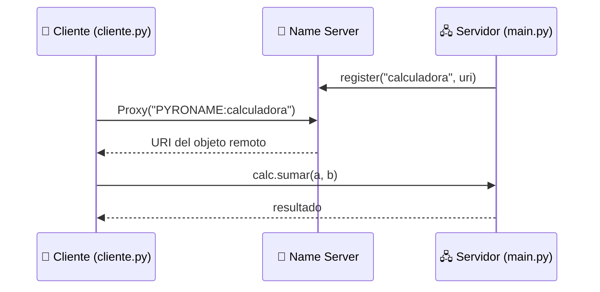

<div align="center">

# 🧮 Calculadora Remota con Pyro4

### Invoca operaciones matemáticas en otra máquina como si fueran funciones locales


</div>

---

## 📖 Descripción

Este proyecto implementa una **calculadora distribuida** utilizando **Pyro4** (*Python Remote Objects*), una librería que permite el **acceso a objetos remotos (RPC / RMI)** en Python.

El **servidor** expone un objeto `Calc` con cuatro operaciones aritméticas y lo registra en un **Name Server**. El **cliente** lo localiza por su nombre lógico (`calculadora`) y ejecuta los métodos de forma transparente, sin preocuparse de sockets, serialización ni direcciones de red.

---

## ✨ Características

| | Característica |
|---|---|
| ➕ | **Suma**, **resta**, **multiplicación** y **división** remotas |
| 🔎 | **Descubrimiento por nombre** mediante el Name Server de Pyro4 (`PYRONAME:calculadora`) |
| 🛡️ | **Manejo de división por cero** controlado desde el servidor |
| ✅ | **Validación de entradas** numéricas en el cliente |
| 🖥️ | Interfaz de consola simple e interactiva |

---

## 🏗️ Arquitectura



**Flujo en resumen:**

1. El **Name Server** actúa como directorio de objetos remotos.
2. El **servidor** crea un `Daemon`, registra la clase `Calc` y publica su URI bajo el nombre `calculadora`.
3. El **cliente** pide al Name Server la ubicación del objeto y obtiene un *proxy* con el que invoca los métodos remotos.

---

## 📁 Estructura del proyecto

```
📦 calculadora-pyro4
 ┣ 📜 main.py       # Servidor: expone y registra la clase Calc
 ┣ 📜 cliente.py    # Cliente: menú interactivo por consola
 ┗ 📜 README.md     # Documentación
```

---

## ⚙️ Requisitos

- **Python 3.x**
- **Pyro4**

```bash
pip install Pyro4
```

---

## 🚀 Puesta en marcha

Necesitarás **tres terminales**, y deben ejecutarse **en este orden**:

### 1️⃣ Iniciar el Name Server

```bash
python -m Pyro4.naming
```

### 2️⃣ Iniciar el servidor

```bash
python main.py
```

Verás el mensaje:

```
Servidor de calculadora listo.
```

### 3️⃣ Ejecutar el cliente

```bash
python cliente.py
```

> 💡 **Importante:** si el Name Server no está activo, tanto el servidor como el cliente fallarán al intentar localizarlo.

---

## 🎮 Ejemplo de uso

```text
--- Calculadora Remota con Pyro4 ---
Ingresa el primer dígito (número): 12
Ingresa el segundo dígito (número): 4

Selecciona una operación:
1. Sumar
2. Restar
3. Multiplicar
4. Dividir
Opción (1-4): 4
Resultado: 3.0
```

---

## 🔧 Métodos expuestos

Definidos en la clase `Calc` (decorada con `@Pyro4.expose`):

| Método | Parámetros | Descripción | Retorno |
|---|---|---|---|
| `sumar(a, b)` | `a`, `b` | Suma dos números | `a + b` |
| `restar(a, b)` | `a`, `b` | Resta `b` de `a` | `a - b` |
| `multiplicar(a, b)` | `a`, `b` | Multiplica dos números | `a * b` |
| `dividir(a, b)` | `a`, `b` | Divide `a` entre `b` | `a / b` o `"Error: División por cero"` si `b == 0` |

---

## 🧯 Manejo de errores

| Situación | Comportamiento |
|---|---|
| Entrada no numérica | El cliente muestra *"Por favor, ingresa números válidos."* y termina |
| Opción fuera de 1–4 | El cliente muestra *"Opción inválida."* |
| División entre cero | El servidor devuelve el texto `Error: División por cero` |

---

## 🧠 Conceptos clave

- **RPC / RMI:** invocación de métodos en un proceso remoto como si fueran locales.
- **Proxy:** objeto local que representa al objeto remoto y reenvía las llamadas.
- **Daemon:** proceso del servidor que atiende las peticiones entrantes (`requestLoop`).
- **Name Server:** servicio de nombres que desacopla al cliente de la dirección física del servidor.

---

## 🛠️ Tecnologías

- 🐍 [Python](https://www.python.org/)
- 🔗 [Pyro4](https://pyro4.readthedocs.io/)

---

<div align="center">

⭐ Si este proyecto te fue útil, ¡no olvides dejar una estrella en el repositorio! ⭐

</div>