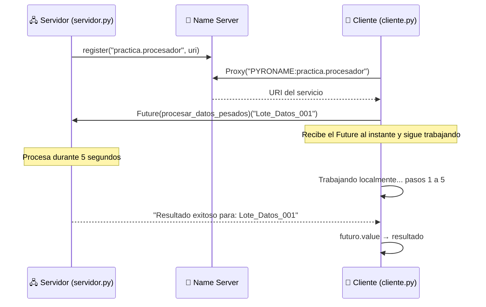

<div align="center">

# ⚡ Peticiones Asíncronas con Pyro4.Future

### El cliente delega una tarea pesada al servidor y **sigue trabajando** mientras espera el resultado


</div>

---

## 📖 Descripción

Por defecto, una llamada RPC es **síncrona**: el cliente se queda esperando hasta que el servidor responde. Este proyecto muestra cómo evitarlo con **`Pyro4.Future`**.

El **servidor** expone un servicio (`ProcesadorArchivos`) cuyo método `procesar_datos_pesados` simula una tarea intensiva de **5 segundos**. El **cliente** lo invoca de forma asíncrona, recibe de inmediato un objeto *Future* y, mientras el servidor trabaja, **realiza otras tareas locales**. Solo cuando necesita el resultado lo solicita con `.value`.

> 💡 **Idea central:** la petición se envía, el cliente no se bloquea y el resultado se recoge después; si aún no está listo, el cliente espera únicamente el tiempo restante.

---

## ✨ Características

| | Característica |
|---|---|
| 🚀 | **Invocación no bloqueante** con `Pyro4.Future` |
| 🧵 | El cliente **ejecuta tareas locales en paralelo** a la tarea remota |
| ⏱️ | **Espera inteligente:** `.value` bloquea solo si el servidor aún no terminó |
| 🔎 | **Localización por nombre** en el Name Server (`PYRONAME:practica.procesador`) |
| 🧩 | Código **corto y didáctico** para entender programación asíncrona con RPC |

---

## 🏗️ Arquitectura



**Flujo en resumen:**

1. El cliente obtiene un **proxy** y envuelve el método remoto con `Pyro4.Future`.
2. Al llamarlo, la petición se envía y el cliente recibe un **objeto Future** sin esperar.
3. El cliente continúa con su trabajo local (5 pasos de 0.8 s ≈ 4 s).
4. Al leer `futuro.value`, obtiene el resultado; como el servidor necesita 5 s, el cliente solo espera **el segundo restante**.

---

## 📁 Estructura del proyecto

```
📦 concurrent-async-callbacks
 ┣ 📜 servidor.py   # Expone ProcesadorArchivos y simula una tarea de 5 s
 ┣ 📜 cliente.py    # Invoca el método de forma asíncrona con Pyro4.Future
 ┗ 📜 README.md     # Documentación
```

---

## ⚙️ Requisitos

- **Python 3.x**
- **Pyro4**

```bash
pip install Pyro4
```

---

## 🚀 Ejecución paso a paso

Abre **tres terminales** en la carpeta del proyecto y respeta el **orden**:

### 1️⃣ Iniciar el Name Server

```bash
python -m Pyro4.naming
```

Debe permanecer en ejecución.

### 2️⃣ Iniciar el servidor

```bash
python servidor.py
```

Salida esperada:

```
Servidor de procesamiento asíncrono activo.
```

### 3️⃣ Ejecutar el cliente

```bash
python cliente.py
```

Salida esperada en el **cliente**:

```
Enviando petición de procesamiento al servidor...
El cliente no está bloqueado. Ejecutando otras tareas locales...
Trabajando localmente... paso 1
Trabajando localmente... paso 2
Trabajando localmente... paso 3
Trabajando localmente... paso 4
Trabajando localmente... paso 5

Esperando el resultado final del servidor (si aún no termina)...
✅ Servidor respondió: Resultado exitoso para: Lote_Datos_001
```

Salida esperada en el **servidor**:

```
Iniciando procesamiento de: Lote_Datos_001...
Procesamiento terminado.
```

> 🔁 Puedes ejecutar el cliente varias veces mientras el servidor y el Name Server sigan activos.
> ⛔ Para detener cualquier proceso, presiona `Ctrl + C` en su terminal.

---

## 🔬 Síncrono vs. asíncrono

| | 🐢 Llamada síncrona | ⚡ Llamada asíncrona (`Pyro4.Future`) |
|---|---|---|
| Al invocar | El cliente **espera** los 5 s sin hacer nada | El cliente **recibe un Future** y continúa |
| Trabajo local | Solo después de recibir la respuesta | **Durante** el procesamiento del servidor |
| Resultado | Se obtiene al terminar la llamada | Se obtiene con `futuro.value` cuando se necesite |
| Tiempo total aproximado | 5 s de espera + 4 s de trabajo local = **≈ 9 s** | Ambos se solapan: **≈ 5 s** |

---

## 🔧 Servicio expuesto

Definido en la clase `ProcesadorArchivos` (decorada con `@Pyro4.expose`):

| Método | Parámetro | Descripción | Retorno |
|---|---|---|---|
| `procesar_datos_pesados(datos)` | `datos`: identificador o contenido a procesar | Simula una tarea intensiva (`time.sleep(5)`) e imprime el inicio y el fin en el servidor | `"Resultado exitoso para: <datos>"` |

**Nombre registrado en el Name Server:** `practica.procesador`

---

## 🧠 Conceptos clave

- **Llamada asíncrona:** la petición se envía y el cliente no queda bloqueado esperando la respuesta.
- **`Pyro4.Future`:** envuelve un método remoto para que su invocación devuelva un resultado diferido.
- **`.value`:** obtiene el resultado del Future; bloquea **solo** si el servidor aún no ha terminado.
- **Proxy:** objeto local que representa al objeto remoto y reenvía las llamadas.
- **Name Server:** asocia el nombre lógico `practica.procesador` con la URI del servicio.

---

## 🩺 Solución de problemas

| Error | Causa probable | Solución |
|---|---|---|
| `NamingError: Failed to locate the nameserver` | El Name Server no está en ejecución | Inicia `python -m Pyro4.naming` antes que el servidor y el cliente |
| `NamingError: unknown name: practica.procesador` | El servidor no está corriendo o no se registró | Ejecuta `python servidor.py` y espera el mensaje de que está activo |
| `CommunicationError` | El servidor se detuvo durante la petición | Reinicia `servidor.py` y vuelve a ejecutar el cliente |

---

## 🛠️ Tecnologías

- 🐍 [Python](https://www.python.org/)
- 🔗 [Pyro4](https://pyro4.readthedocs.io/)

---

<div align="center">

⭐ Si este proyecto te fue útil, ¡no olvides dejar una estrella en el repositorio! ⭐

</div>
