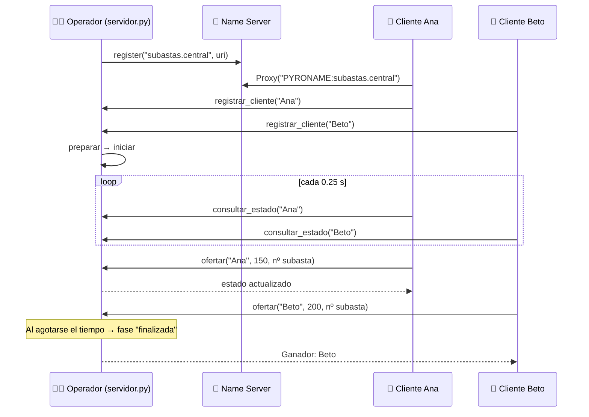
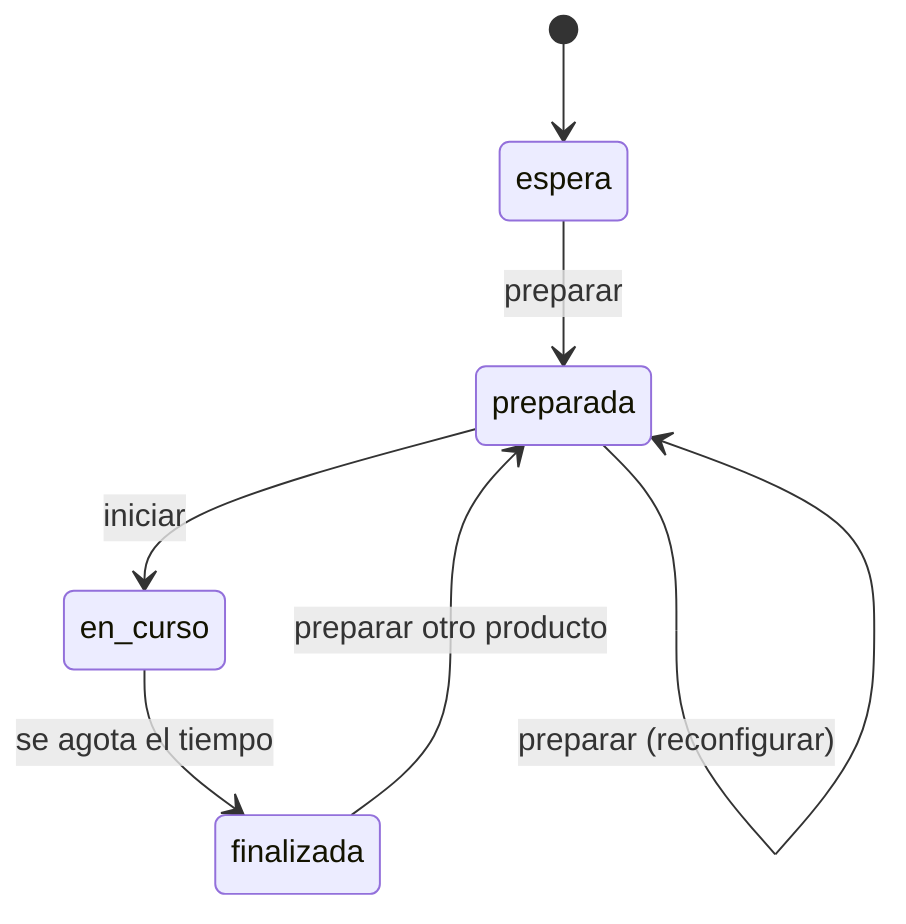

<div align="center">

# 🔨 Sistema de Subastas Distribuido (Pyro4)

### Una sala de subastas en tiempo real: el **operador** controla el producto y el tiempo, los **participantes** ofertan desde sus propias consolas


</div>

---

## 📖 Descripción

Este proyecto implementa una **subasta distribuida** con **Pyro4** (*Python Remote Objects*). Un único objeto remoto, `Subasta`, es compartido por todos los clientes y mantiene el estado de la sala: participantes, producto, precio actual, mejor postor y tiempo restante.

Hay dos roles bien diferenciados:

| Rol | Qué hace |
|---|---|
| 🧑‍💼 **Operador (servidor)** | Prepara el producto (nombre, precio base y duración), inicia la subasta y puede cerrar el servidor |
| 🙋 **Participantes (clientes)** | Se registran con un nombre, ven el estado de la sala en vivo, ofertan montos y salen cuando quieran |

> 💡 **Idea central:** todos comparten **una sola instancia** del objeto remoto y las ofertas se validan **bajo un bloqueo (`Lock`)**, de modo que dos ofertas simultáneas nunca se pisan entre sí.

---

## ✨ Características

| | Característica |
|---|---|
| 🏛️ | **Sala compartida** con una única instancia de `Subasta` registrada como `subastas.central` |
| 🔄 | **Actualizaciones en vivo:** cada cliente consulta cambios cada 0.25 s desde un hilo propio |
| 🔒 | **Concurrencia segura** con `threading.Lock` en todas las operaciones sobre el estado |
| 🧾 | **Control de versiones del estado:** una consulta antigua nunca sobrescribe una oferta más reciente |
| 🎯 | **Oferta ligada al producto:** si el producto cambia mientras escribes, la oferta se rechaza |
| 🛡️ | **Validación estricta** de nombres y montos (números positivos y finitos) |
| 🔐 | **Métodos del operador privados:** `_preparar_subasta` e `_iniciar_subasta` no se exponen por Pyro4 |
| ⌨️ | **Consola interactiva** con `prompt_toolkit`: los mensajes en vivo no rompen lo que estás escribiendo |
| 🧹 | **Cierre limpio:** el servidor retira su nombre del Name Server y el cliente se da de baja al salir |

---

## 🏗️ Arquitectura



### Fases de la subasta



| Fase | Significado |
|---|---|
| `espera` | Sala abierta, aún sin producto |
| `preparada` | Producto configurado; los participantes esperan que el operador inicie |
| `en_curso` | Se aceptan ofertas hasta que termine el tiempo |
| `finalizada` | Se muestra el ganador; el operador puede preparar otro producto |

---

## 📁 Estructura del proyecto

```
📦 distributed-auction-system
 ┣ 📜 servidor.py   # Objeto remoto Subasta + consola del operador
 ┣ 📜 cliente.py    # Consola del participante (ofertas y estado en vivo)
 ┣ 📜 consola.py    # Presentación del estado, compartida por servidor y clientes
 ┗ 📜 README.md     # Documentación
```

> ⚠️ `consola.py` es importado **tanto por el servidor como por el cliente**. Debe estar en la misma carpeta que ambos scripts.

---

## ⚙️ Requisitos

- **Python 3.x**
- **Pyro4**
- **prompt_toolkit**

```bash
pip install Pyro4 prompt_toolkit
```

---

## 🚀 Ejecución paso a paso

Necesitarás **al menos cuatro terminales** (Name Server, servidor y dos o más clientes) abiertas en la carpeta del proyecto. Respeta el **orden**:

### 1️⃣ Iniciar el Name Server

```bash
python -m Pyro4.naming
```

### 2️⃣ Iniciar el servidor (operador)

```bash
python servidor.py
```

Verás la dirección del servicio y el aviso de que la sala está lista:

```
Dirección del servicio: PYRO:obj_...@localhost:...
Sala de espera lista. Configura los productos desde esta consola.
Comandos del servidor: preparar, iniciar, estado, ayuda, salir.
Servidor >
```

### 3️⃣ Conectar los participantes (una terminal por cliente)

```bash
python cliente.py
```

Cada cliente escribe su **nombre** (no puede repetirse) y entra a la sala:

```
Ingresa tu nombre: Ana

--- Sala de espera ---
Participantes: Ana
El servidor configura e inicia las subastas.
Escribe un monto para ofertar. Comandos: estado, ayuda, salir.
```

### 4️⃣ Preparar e iniciar la subasta (desde el servidor)

```text
Servidor > preparar
Producto a subastar: Laptop
Precio base: 100
Duración en segundos: 60
Producto preparado. Escribe 'iniciar' cuando estén listos.

Servidor > iniciar
```

### 5️⃣ Ofertar (desde los clientes)

```text
Ingrese su oferta o escriba 'salir' para terminar: 150
Oferta aceptada: $150.00.
```

Al terminar el tiempo, todos ven el ganador:

```
--- Subasta finalizada ---
Participantes: Ana, Beto
Producto: Laptop | Precio: $200.00
Ganador: Beto.
El servidor puede preparar otro producto. Los participantes pueden salir o esperar.
```

> 🔁 Tras una subasta puedes ejecutar `preparar` de nuevo para subastar otro producto con los mismos participantes.
> ⛔ Para cerrar el servidor escribe `salir` en su consola; para cerrar un cliente, `salir` o `Ctrl + C`.

---

## 🎮 Comandos

### 🧑‍💼 Operador (`servidor.py`)

| Comando | Acción |
|---|---|
| `preparar` | Solicita producto, precio base y duración en segundos |
| `iniciar` | Comienza la subasta preparada (empieza a correr el tiempo) |
| `estado` | Muestra el estado actual de la sala |
| `ayuda` | Lista los comandos |
| `salir` | Cierra el servidor y retira el servicio del Name Server |

### 🙋 Participante (`cliente.py`)

| Entrada | Acción |
|---|---|
| Un número (ej. `150`) | Oferta ese monto; debe superar el precio actual |
| `estado` | Consulta el estado de la sala |
| `ayuda` | Muestra las reglas básicas |
| `salir` | Se desconecta sin detener el servidor |

> Si un participante escribe `preparar` o `iniciar`, el sistema le indica que solo el operador puede hacerlo.

---

## 🔧 Métodos expuestos por Pyro4

Definidos en la clase `Subasta` (decorada con `@Pyro4.expose`):

| Método | Descripción | Errores posibles |
|---|---|---|
| `registrar_cliente(nombre)` | Registra al participante y devuelve el estado | `ValueError` si el nombre está vacío o ya conectado |
| `consultar_estado(nombre)` | Devuelve el estado actual de la sala | `ValueError` si el cliente no está registrado |
| `ofertar(nombre, monto, numero_subasta)` | Registra una oferta si es válida | `ValueError` (monto inválido, no supera el precio, producto cambió) · `RuntimeError` (no hay subasta en curso) |
| `salir_cliente(nombre)` | Da de baja al participante | `ValueError` si no estaba registrado |

**Métodos privados (solo operador local, no accesibles por red):** `_preparar_subasta`, `_iniciar_subasta`, `_consultar_sala`.

**Nombre registrado en el Name Server:** `subastas.central`

---

## 🧯 Reglas y manejo de errores

| Situación | Comportamiento |
|---|---|
| Nombre vacío o repetido | El servidor lo rechaza con un mensaje claro |
| Monto no numérico, cero, negativo, infinito o `NaN` | Se rechaza (validación en cliente y servidor) |
| Oferta menor o igual al precio actual | Se rechaza e indica el precio vigente |
| Ofertar sin subasta en curso | `RuntimeError`: *"No hay una subasta en curso. Espera al inicio."* |
| El producto cambió mientras escribías | Se rechaza: *"El producto cambió. Revisa la subasta y vuelve a ofertar."* |
| Preparar un producto con otra subasta en curso | *"Espera a que termine la subasta actual."* |
| Se pierde la conexión con la sala | El cliente avisa y pide presionar Enter para salir |
| Name Server inactivo | El servidor indica ejecutar `python -m Pyro4.naming` |

---

## 🧠 Conceptos clave

- **Objeto remoto compartido (singleton):** se registra la **instancia** (`servidor.register(subasta)`), no la clase, por lo que todos los clientes usan el mismo estado.
- **`threading.Lock`:** valida y actualiza dentro del mismo bloqueo para evitar *race conditions* en las ofertas.
- **Hilos (`Thread`):** el servidor atiende a los clientes (`requestLoop`) mientras el operador usa su consola; cada cliente usa un hilo de consulta con su propia conexión.
- **Versionado del estado (`version`):** cada cambio incrementa la versión para descartar respuestas antiguas.
- **`numero_subasta`:** liga cada oferta al producto visible al comenzar a escribir.
- **Tiempo con `monotonic()`:** el plazo no depende de cambios en el reloj del sistema.
- **Métodos privados en Pyro4:** los que empiezan con `_` no se exponen, protegiendo las acciones del operador.
- **`patch_stdout` (prompt_toolkit):** permite imprimir avisos en vivo sin romper la línea de entrada.
- **Name Server:** asocia el nombre lógico `subastas.central` con la URI del objeto.

---

## ⚠️ Consideraciones

- Todo el estado vive **en memoria**: al cerrar el servidor se pierde.
- El servidor se crea con `Pyro4.Daemon()` sin parámetros, por lo que por defecto está pensado para ejecutarse en **la misma máquina**. Para usarlo en red local habría que configurar la dirección del daemon y del Name Server (por ejemplo, con las variables de entorno `PYRO_HOST` y `PYRO_NS_HOST`).
- El ganador es el **mejor postor al terminar el tiempo**; si nadie oferta, se muestra *"Sin ofertas"*.

---

## 🩺 Solución de problemas

| Error | Causa probable | Solución |
|---|---|---|
| *"No se pudo conectar al servidor de nombres..."* | El Name Server no está activo | Ejecuta `python -m Pyro4.naming` antes del servidor |
| *"No se pudo conectar al servidor de subastas"* | El servidor no está corriendo | Inicia `python servidor.py` y vuelve a abrir el cliente |
| *"Ese nombre ya está conectado"* | Otro cliente usa el mismo nombre | Elige un nombre distinto |
| `ModuleNotFoundError: consola` | Falta `consola.py` junto a los scripts | Colócalo en la misma carpeta que `servidor.py` y `cliente.py` |
| `ModuleNotFoundError: prompt_toolkit` | Dependencia no instalada | `pip install prompt_toolkit` |

---

## 🛠️ Tecnologías

- 🐍 [Python](https://www.python.org/)
- 🔗 [Pyro4](https://pyro4.readthedocs.io/)
- ⌨️ [prompt_toolkit](https://python-prompt-toolkit.readthedocs.io/)

---

<div align="center">

⭐ Si este proyecto te fue útil, ¡no olvides dejar una estrella en el repositorio! ⭐

</div>