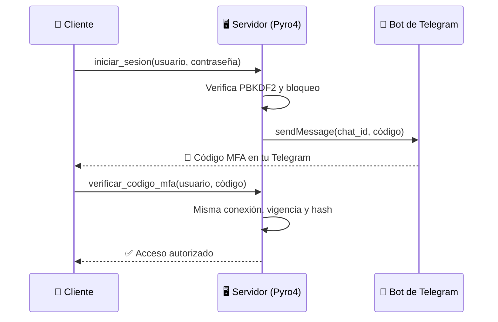

<div align="center">

# 🔐 Autenticación MFA con Telegram y Pyro4

### Doble factor de autenticación sobre RPC distribuido, con códigos enviados a tu Telegram


</div>

---

## 📖 Descripción

El servidor comprueba **usuario y contraseña**, envía un **código de 6 dígitos por Telegram** y autoriza el acceso cuando el cliente devuelve ese código. La **misma conexión Pyro4** realiza ambos pasos.

## ✨ Características

| | Característica | Detalle |
|---|---|---|
| 🔑 | Primer factor | Contraseña verificada con PBKDF2-HMAC-SHA256 |
| 📲 | Segundo factor | Código de 6 dígitos enviado al chat privado de Telegram |
| 🔗 | Misma conexión | El código solo se valida desde la conexión que comprobó la contraseña |
| ⏱️ | Expiración | Cada código dura 180 segundos |
| 🚫 | Anti fuerza bruta | Bloqueo de 60 s al tercer fallo |
| 🧵 | Concurrencia | Bloqueo independiente por usuario |
| 🛡️ | Privacidad | Solo se guardan hashes; el token nunca se imprime |

## 🏗️ Arquitectura



## 📁 Estructura del proyecto

```text
mfa-telegram-bot-pyro4/
├── 📄 autenticacion.py   # Servicio MFA, usuarios, intentos y bloqueos
├── 💻 cliente.py         # Cliente de consola (usuario, contraseña y código)
├── ⚙️ configuracion.py   # Obtención del token del bot
├── ❗ excepciones.py     # Excepciones personalizadas para Pyro4
├── 🖥️ servidor.py        # Registro de usuarios y servidor Pyro4
├── 🤖 telegram_bot.py    # Cliente HTTPS de Telegram y consulta de chat_id
├── 🧪 test_sistema.py    # Pruebas automáticas de todos los módulos
├── 📦 requirements.txt   # Dependencias (Pyro4==4.82)
└── 🙈 .gitignore         # Excluye .telegram_token y archivos temporales
```

---

## 🛠️ Preparación

> 🐍 Requiere **Python 3.10 o superior**.

Desde la raíz del proyecto, con el entorno `.venv` activado:

```powershell
python -m pip install -r mfa-telegram-bot-pyro4\requirements.txt
```

1. En Telegram, abre [@BotFather](https://t.me/BotFather), utiliza `/newbot` y
   sigue sus instrucciones para obtener el token de tu bot.
2. Abre una conversación privada con tu nuevo bot y envía `/start`. Cada usuario
   que recibirá códigos debe iniciar su propia conversación con el bot.
3. Consulta los identificadores de esos chats:

   ```powershell
   python mfa-telegram-bot-pyro4\telegram_bot.py
   ```

   La utilidad carga el token configurado (o lo pide sin mostrarlo) y consulta `getUpdates`. Muestra solo
   los `chat_id` de conversaciones privadas, sin imprimir los mensajes ni el
   token. Si no hay resultados, envía un nuevo mensaje al bot y repite la consulta.
   Relaciona cada identificador con su usuario al configurar el servidor; puedes
   hacer la consulta después de que cada persona envíe su primer mensaje.

### 🗝️ Configuración del token

El token se obtiene, en orden, de:

1. 🌍 La variable de entorno `TELEGRAM_BOT_TOKEN`.
2. 📄 El archivo local `.telegram_token` de esta carpeta.
3. ⌨️ Una entrada oculta en la consola.

> ⚠️ El archivo está excluido de Git y debe permanecer únicamente en la
> computadora servidor. El cliente no necesita conocer el token.

📚 Referencias oficiales: [crear un bot](https://core.telegram.org/bots/features#botfather),
[getUpdates](https://core.telegram.org/bots/api#getupdates) y
[sendMessage](https://core.telegram.org/bots/api#sendmessage).

---

## 🚀 Ejecución local

Abre **tres terminales** en la raíz del proyecto, con `.venv` activado.

### 1️⃣ Servidor de nombres

Si todavía no está activo:

```powershell
python -m Pyro4.naming
```

### 2️⃣ Servidor de autenticación

```powershell
python mfa-telegram-bot-pyro4\servidor.py
```

Si no hay un token configurado, ingrésalo cuando se solicite. Registra cada usuario con su contraseña y su
`chat_id` privado. Deja el nombre de usuario vacío para terminar el registro
y comenzar a atender conexiones. Debes registrar al menos una cuenta.

### 3️⃣ Cliente

```powershell
python mfa-telegram-bot-pyro4\cliente.py
```

Ingresa el usuario y la contraseña configurados en el servidor. Recibirás el
código en Telegram. Escríbelo completo, incluyendo ceros iniciales si los hay.
Si es correcto, aparece `Acceso autorizado`. Puedes escribir `salir` para cancelar.

> 💡 Para conectar otro cliente, abre otra terminal y repite el último comando.

---

## 🧪 Pruebas automáticas

Desde la raíz del proyecto, con `.venv` activado y las dependencias instaladas:

```powershell
python mfa-telegram-bot-pyro4\test_sistema.py
```

El script usa `unittest`, incluido en Python, y muestra el resultado de cada prueba.
Termina con `OK` si todas pasan y devuelve un código de salida distinto de cero si
hay fallos.

Comprueba usuarios y contraseñas, códigos MFA, expiración, reintentos, bloqueos,
concurrencia, configuración del token, peticiones HTTP de Telegram, excepciones y
los flujos de consola del cliente y del servidor. También prueba el cliente con
RPC real y un Name Server temporal en `127.0.0.1`, usando puertos libres que se
cierran al terminar.

Las llamadas a Telegram se simulan y la configuración usa archivos temporales.
No hace falta un token, acceso a Internet ni iniciar los servidores manualmente.
Estas pruebas no comprueban la disponibilidad del servicio real de Telegram.

Para ejecutar una sola prueba:

```powershell
cd mfa-telegram-bot-pyro4
python -m unittest test_sistema.PruebasServicio.test_codigo_correcto_se_consume -v
```

---

## 📜 Reglas de autenticación

- 🏷️ El servicio se registra como `autenticacion.mfa` en el Name Server.
- 🎲 Los códigos se generan con `secrets`, tienen 6 dígitos y duran 180 segundos
  desde que Telegram confirma el envío. No se devuelven al cliente por Pyro4.
- #️⃣ Solo se guarda el hash del código. Un nuevo envío reemplaza al anterior y una
  validación correcta lo consume; no puede reutilizarse.
- 🔗 La verificación exige la conexión que comprobó la contraseña. Otro cliente
  no puede validar ese código ni gastar sus intentos MFA.
- 🚫 Se suman los fallos de contraseña y de código para cada cuenta registrada.
  Al tercer fallo se bloquea durante 60 segundos y se invalida su código.
  Solicitar otro código no reinicia este contador. Se reinicia después de un MFA
  correcto o al terminar el bloqueo.
- ⌛ Un código expirado se elimina. Si Telegram falla, no se activa un código ni
  se anuncia un envío exitoso.
- 🧵 Cada usuario tiene su propio bloqueo para evitar validaciones simultáneas y
  permitir que otras cuentas continúen mientras se envía un mensaje a Telegram.
- 🔒 Las contraseñas se almacenan en memoria como hashes PBKDF2-HMAC-SHA256, con
  sal aleatoria y 600 000 iteraciones; no se conserva la contraseña original.
- 🧠 Las cuentas, códigos y bloqueos permanecen en memoria. Al reiniciar el servidor
  debes registrar nuevamente los usuarios.

Las excepciones personalizadas `CredencialesInvalidas`, `CodigoExpirado`,
`CodigoIncorrecto`, `CuentaBloqueada` y `ErrorTelegram` se registran para que Pyro4
las transmita al cliente. Los errores HTTP no muestran la URL que contiene el token.

### ❗ Excepciones del sistema

| Excepción | Cuándo ocurre |
|---|---|
| `CredencialesInvalidas` | Usuario o contraseña incorrectos |
| `CodigoIncorrecto` | Código erróneo o de otra conexión |
| `CodigoExpirado` | Superó los 180 segundos |
| `CuentaBloqueada` | Tres fallos seguidos (60 s de bloqueo) |
| `ErrorTelegram` | Telegram no confirmó la operación |

---

## 🌐 Otras computadoras

Usa la IPv4 real del servidor; este ejemplo utiliza `172.17.44.103`.

**🖥️ En el servidor, primera terminal:**

```powershell
python -m Pyro4.naming -n 172.17.44.103 -p 9090
```

**🖥️ En el servidor, segunda terminal:**

```powershell
$env:PYRO_HOST = "172.17.44.103"
$env:PYRO_NS_HOST = "172.17.44.103"
python mfa-telegram-bot-pyro4\servidor.py
```

**💻 En cada cliente:**

```powershell
$env:PYRO_NS_HOST = "172.17.44.103"
python mfa-telegram-bot-pyro4\cliente.py
```

Ambos servidores deben mantenerse abiertos. El servicio consulta directamente
el Name Server indicado, sin búsqueda automática de otros equipos. El envío a
Telegram usa HTTPS.

> 🚨 **Importante:** Pyro4 no cifra las credenciales por defecto: las pruebas
> sin TLS deben limitarse a un entorno local controlado; para redes no confiables
> se requiere configurar TLS también en Pyro4.
