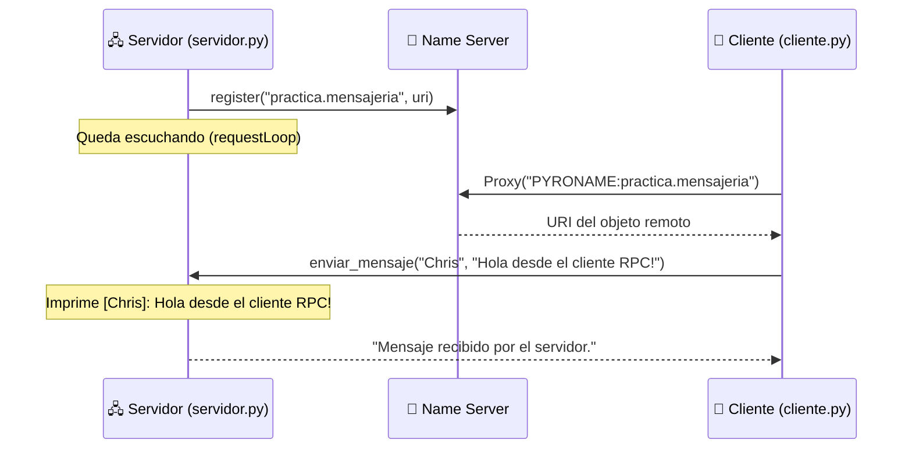

<div align="center">

# 📨 Sistema de Mensajería con Name Server (Pyro4)

### Un cliente envía mensajes a un servidor remoto localizándolo solo por su **nombre lógico**


</div>

---

## 📖 Descripción

Este proyecto demuestra el uso del **Name Server de Pyro4** en una arquitectura **cliente-servidor basada en RPC** (*Remote Procedure Call*).

El **servidor** publica un servicio de mensajería (`ServicioMensajes`) y lo registra en el Name Server bajo el nombre `practica.mensajeria`. El **cliente** ya no necesita conocer la URI larga y dinámica del objeto remoto: le basta con el **nombre lógico** para localizarlo y enviarle un mensaje.

> 💡 **Idea central:** el Name Server desacopla al cliente de la ubicación real del servidor. La URI cambia en cada ejecución, pero el nombre `practica.mensajeria` siempre es el mismo.

---

## ✨ Características

| | Característica |
|---|---|
| 🔎 | **Descubrimiento por nombre** con `PYRONAME:practica.mensajeria` |
| 📡 | **Registro dinámico** de la URI en el Name Server al iniciar el servidor |
| 📨 | **Envío de mensajes** con remitente y contenido |
| ✅ | **Confirmación de recepción** devuelta al cliente |
| 🧩 | Código **simple y didáctico**, ideal para comprender RPC y servicios de nombres |

---

## 🏗️ Arquitectura



**Flujo en resumen:**

1. El **Name Server** funciona como directorio de objetos remotos.
2. El **servidor** crea un `Daemon`, registra la clase `ServicioMensajes` y publica su URI en el Name Server.
3. El **cliente** consulta el nombre lógico, obtiene un *proxy* e invoca `enviar_mensaje` como si fuera una función local.

---

## 📁 Estructura del proyecto

```
📦 nameserver-notification-system
 ┣ 📜 servidor.py   # Expone y registra el servicio de mensajería
 ┣ 📜 cliente.py    # Envía un mensaje al servicio remoto
 ┗ 📜 README.md     # Documentación
```

---

## ⚙️ Requisitos

- **Python 3.x**
- **Pyro4**

```bash
pip install Pyro4
```

---

## 🚀 Ejecución paso a paso

Necesitarás **tres terminales** abiertas en la carpeta del proyecto. Es **importante respetar el orden**:

### 1️⃣ Iniciar el Name Server

```bash
python -m Pyro4.naming
```

Debe quedar en ejecución y mostrar un mensaje similar a:

```
Name server running on ...
```

### 2️⃣ Iniciar el servidor

```bash
python servidor.py
```

Salida esperada:

```
Servicio de mensajería registrado en el Name Server.
```

El servidor queda **escuchando peticiones** de forma indefinida.

### 3️⃣ Ejecutar el cliente

```bash
python cliente.py
```

Salida esperada en el **cliente**:

```
Respuesta del servidor: Mensaje recibido por el servidor.
```

Salida esperada en el **servidor**:

```
[Chris]: Hola desde el cliente RPC!
```

> 🔁 Puedes ejecutar el cliente tantas veces como quieras mientras el servidor y el Name Server sigan activos.
> ⛔ Para detener cualquiera de los procesos, presiona `Ctrl + C` en su terminal.

---

## 🔧 Servicio expuesto

Definido en la clase `ServicioMensajes` (decorada con `@Pyro4.expose`):

| Método | Parámetros | Descripción | Retorno |
|---|---|---|---|
| `enviar_mensaje(remitente, mensaje)` | `remitente`: nombre de quien envía<br>`mensaje`: texto del mensaje | Imprime el mensaje en el servidor con el formato `[remitente]: mensaje` | `"Mensaje recibido por el servidor."` |

**Nombre registrado en el Name Server:** `practica.mensajeria`

---

## 🧠 Conceptos clave

- **RPC:** invocar métodos de un objeto que vive en otro proceso o máquina como si fueran locales.
- **Name Server:** servicio de nombres que asocia un nombre lógico con la URI de un objeto remoto.
- **URI dinámica:** la dirección que genera Pyro4 al registrar el objeto; cambia en cada ejecución del servidor.
- **Proxy:** objeto local que representa al objeto remoto y reenvía las llamadas.
- **Daemon:** proceso del servidor que atiende las peticiones entrantes (`requestLoop`).

---

## 🩺 Solución de problemas

| Error | Causa probable | Solución |
|---|---|---|
| `NamingError: Failed to locate the nameserver` | El Name Server no está en ejecución | Inicia `python -m Pyro4.naming` antes que el servidor y el cliente |
| `NamingError: unknown name: practica.mensajeria` | El servidor no está corriendo o no se registró | Ejecuta `python servidor.py` y espera el mensaje de registro |
| `CommunicationError` | El servidor se detuvo después de registrarse | Reinicia `servidor.py` y vuelve a ejecutar el cliente |

---

## 🛠️ Tecnologías

- 🐍 [Python](https://www.python.org/)
- 🔗 [Pyro4](https://pyro4.readthedocs.io/)

---

<div align="center">

⭐ Si este proyecto te fue útil, ¡no olvides dejar una estrella en el repositorio! ⭐

</div>