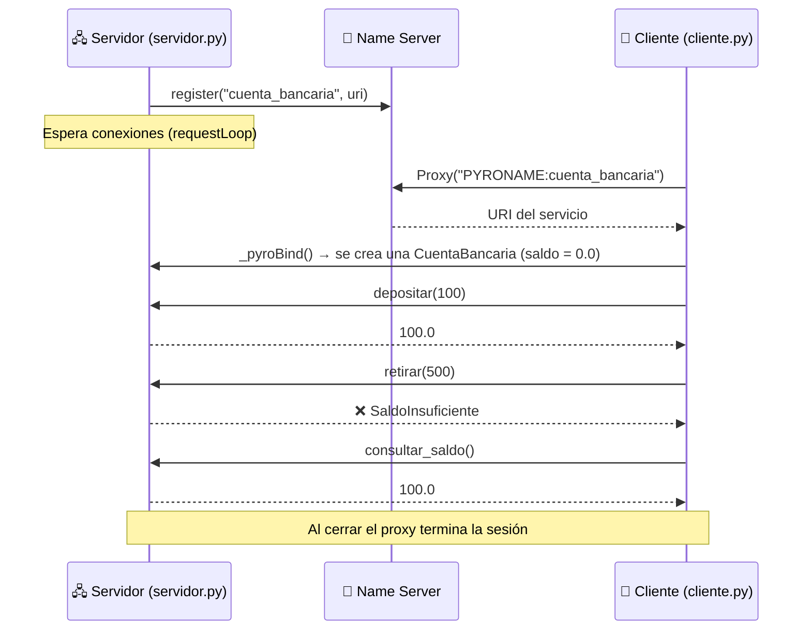

<div align="center">

# 🏦 Banco Distribuido con Estado (Pyro4)

### Una cuenta bancaria remota que **recuerda su saldo** entre operaciones, con una instancia independiente por cliente


</div>

---

## 📖 Descripción

Este proyecto implementa una **cuenta bancaria distribuida** con **Pyro4** (*Python Remote Objects*). A diferencia de un servicio sin estado, aquí el objeto remoto **conserva el saldo** mientras dura la conexión del cliente.

Esto se logra con la política de instancia **`session`**: Pyro4 crea **una instancia de `CuentaBancaria` por cada conexión (proxy)**, de modo que cada cliente trabaja con su propia cuenta, aislada de las demás.

El proyecto también muestra cómo **transportar una excepción personalizada** (`SaldoInsuficiente`) desde el servidor hasta el cliente a través de la red.

---

## ✨ Características

| | Característica |
|---|---|
| 💰 | **Depositar**, **retirar** y **consultar saldo** de forma remota |
| 🧠 | **Servicio con estado:** el saldo se mantiene entre operaciones de una misma sesión |
| 👥 | **Una cuenta por cliente** gracias a `instance_mode="session"` |
| 🚫 | **Excepción propia** `SaldoInsuficiente`, serializada y recibida en el cliente |
| 🛡️ | **Validación de montos:** solo números positivos y finitos |
| 🔎 | **Localización por nombre** en el Name Server (`PYRONAME:cuenta_bancaria`) |
| 🔌 | **Manejo de caídas:** mensaje claro si se pierde la conexión o no se encuentra el servicio |

---

## 🏗️ Arquitectura



**Idea clave:** el servidor registra la **clase** (no una instancia). Con la política `session`, Pyro4 instancia `CuentaBancaria` automáticamente para cada nueva conexión y la mantiene viva mientras el proxy siga abierto.

---

## 📁 Estructura del proyecto

```
📦 stateful-distributed-bank
 ┣ 📜 servidor.py      # Define CuentaBancaria y la registra en el Name Server
 ┣ 📜 cliente.py       # Menú interactivo por consola
 ┣ 📜 excepciones.py   # Excepción SaldoInsuficiente + registro en el serializador
 ┗ 📜 README.md        # Documentación
```

> ⚠️ `excepciones.py` es importado **tanto por el servidor como por el cliente**. Ambos deben tener una copia del archivo para que la excepción viaje y se reconstruya correctamente.

---

## ⚙️ Requisitos

- **Python 3.x**
- **Pyro4**

```bash
pip install Pyro4
```

---

## 🚀 Ejecución paso a paso

Abre **tres terminales** en la carpeta del proyecto y respeta el **orden**:

### 1️⃣ Iniciar el Name Server

```bash
python -m Pyro4.naming
```

Debe permanecer en ejecución.

### 2️⃣ Iniciar el servidor

```bash
python servidor.py
```

Salida esperada:

```
Servidor bancario listo. Política de instancia: session.
```

### 3️⃣ Ejecutar el cliente

```bash
python cliente.py
```

Aparecerá el menú:

```
--- Cuenta bancaria ---
1. Depositar
2. Retirar
3. Consultar saldo
4. Salir
Selecciona una opción:
```

> 🔁 Para probar el **aislamiento por sesión**, abre una **cuarta terminal** y ejecuta otro `python cliente.py`: cada cliente tendrá su propio saldo.
> ⛔ Para detener cualquier proceso, presiona `Ctrl + C` en su terminal.

---

## 🎮 Ejemplo de uso

```text
--- Cuenta bancaria ---
1. Depositar
2. Retirar
3. Consultar saldo
4. Salir
Selecciona una opción: 1
Ingresa el monto: 100
Saldo actual: $100.00

Selecciona una opción: 2
Ingresa el monto: 500
No hay saldo suficiente para realizar el retiro.

Selecciona una opción: 2
Ingresa el monto: 40
Saldo actual: $60.00

Selecciona una opción: 3
Saldo actual: $60.00

Selecciona una opción: 4
```

---

## 🔧 Métodos expuestos

Definidos en la clase `CuentaBancaria` (decorada con `@Pyro4.expose` y `@Pyro4.behavior(instance_mode="session")`):

| Método | Parámetro | Descripción | Retorno / Error |
|---|---|---|---|
| `depositar(monto)` | `monto` | Suma el monto al saldo | Nuevo saldo · `ValueError` si el monto no es válido |
| `retirar(monto)` | `monto` | Resta el monto del saldo | Nuevo saldo · `SaldoInsuficiente` si supera el saldo · `ValueError` si el monto no es válido |
| `consultar_saldo()` | — | Devuelve el saldo actual | Saldo actual |

**Nombre registrado en el Name Server:** `cuenta_bancaria`
**Saldo inicial de cada sesión:** `0.0`

---

## 🧯 Manejo de errores

| Situación | Comportamiento |
|---|---|
| Retiro mayor al saldo | El servidor lanza `SaldoInsuficiente` y el cliente muestra su mensaje |
| Monto no numérico, negativo, cero, infinito o `NaN` | El cliente muestra *"Ingresa un monto numérico, positivo y finito."* |
| Opción fuera del menú | *"Opción inválida."* |
| Name Server o servidor inactivos / conexión perdida | El cliente informa que no se pudo conectar y pide mantener abiertos el servidor de nombres y `servidor.py` |

---

## 🧠 Conceptos clave

- **Servicio con estado (*stateful*):** el objeto remoto recuerda datos (aquí, el saldo) entre llamadas.
- **`instance_mode="session"`:** una instancia del objeto por cada conexión de cliente.
- **Proxy como gestor de contexto (`with`):** mantiene la misma conexión abierta durante todo el menú, lo que conserva el saldo, y la cierra al salir.
- **`_pyroBind()`:** fuerza la conexión de inmediato para detectar fallos antes de mostrar el menú.
- **Serialización de excepciones:** `SerializerBase.register_dict_to_class` permite reconstruir `SaldoInsuficiente` en el cliente.
- **Name Server:** asocia el nombre lógico `cuenta_bancaria` con la URI del servicio.

---

## ⚠️ Consideraciones

- El saldo vive **solo en memoria**: al cerrar el cliente (fin de la sesión) o detener el servidor, **se pierde**. No hay persistencia en archivo ni en base de datos.
- Si se pierde la conexión, hay que volver a ejecutar `cliente.py`; se iniciará una **nueva sesión** con saldo `0.0`.

---

## 🩺 Solución de problemas

| Error | Causa probable | Solución |
|---|---|---|
| *"No se pudo conectar con el servicio bancario..."* | Name Server o servidor no están activos | Inicia `python -m Pyro4.naming` y luego `python servidor.py`; después vuelve a ejecutar el cliente |
| `ModuleNotFoundError: excepciones` | Falta `excepciones.py` junto al script | Asegúrate de que `excepciones.py` esté en la misma carpeta que `servidor.py` y `cliente.py` |
| El saldo vuelve a `0` | La sesión terminó (cliente cerrado o conexión perdida) | Es el comportamiento esperado: cada sesión empieza de cero |

---

## 🛠️ Tecnologías

- 🐍 [Python](https://www.python.org/)
- 🔗 [Pyro4](https://pyro4.readthedocs.io/)

---

<div align="center">

⭐ Si este proyecto te fue útil, ¡no olvides dejar una estrella en el repositorio! ⭐

</div>